# The Fifth Element (1997)

**Director:** Luc Besson\
**Genre:** Science Fiction\
**Watched:** 2026-10-25\
**Where:** SBS on Demand\
**Rating:** ★★★★★ (5/5)

***

## Trailer



## Stills



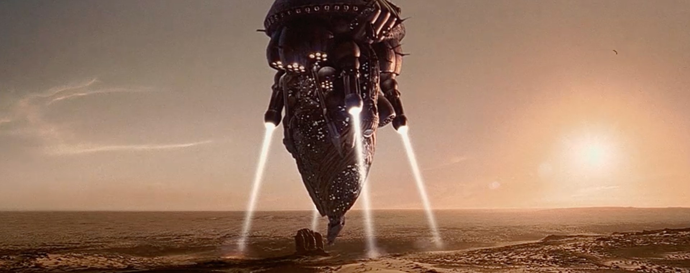



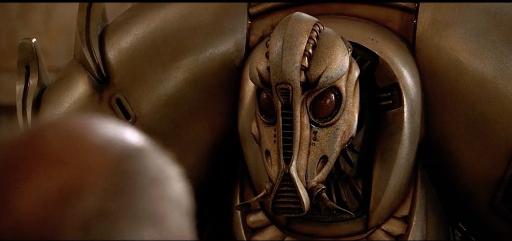



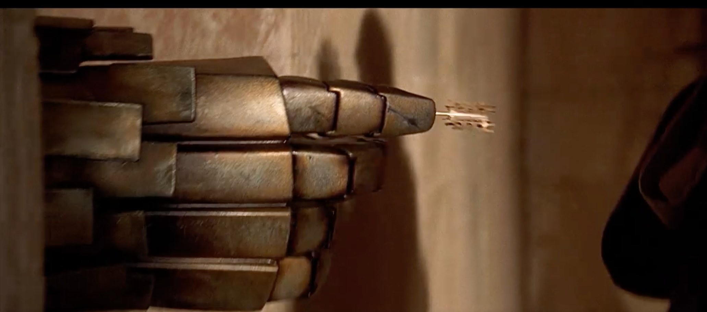



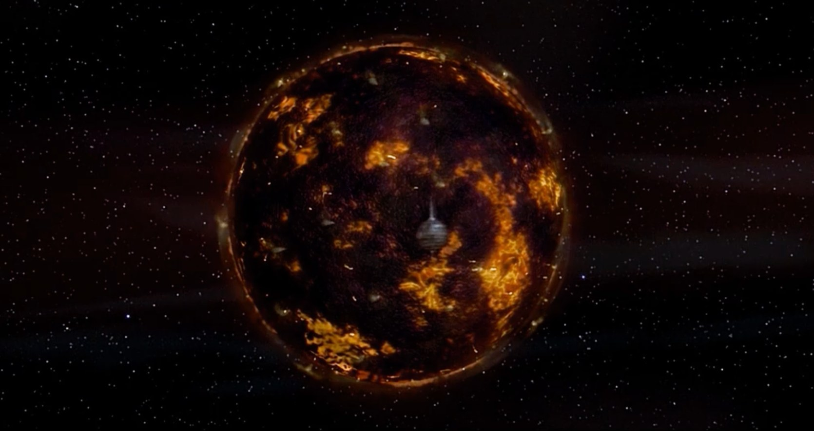



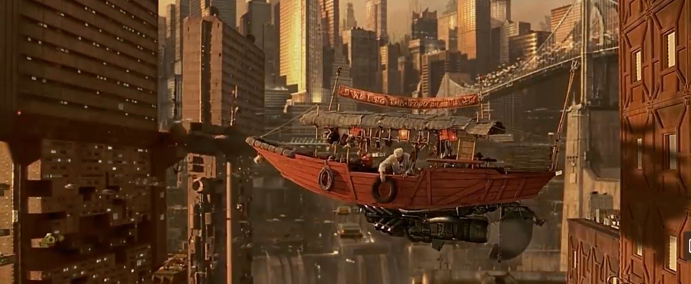



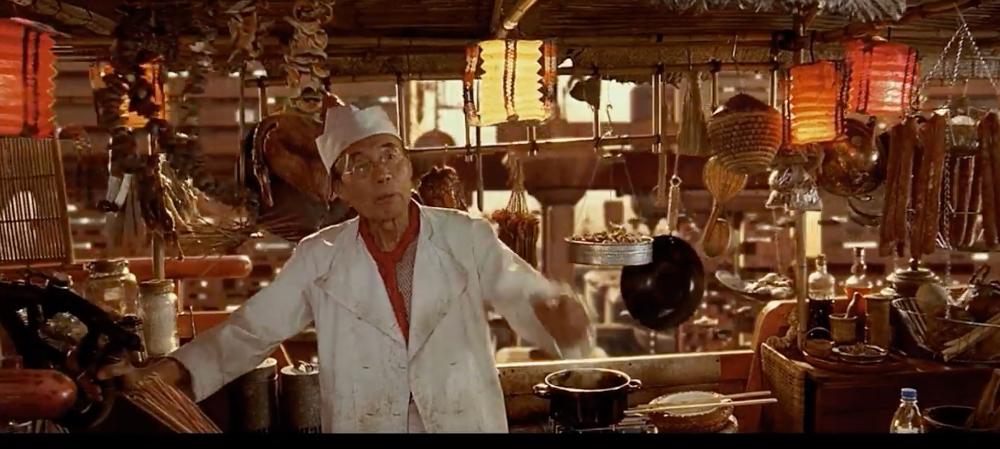



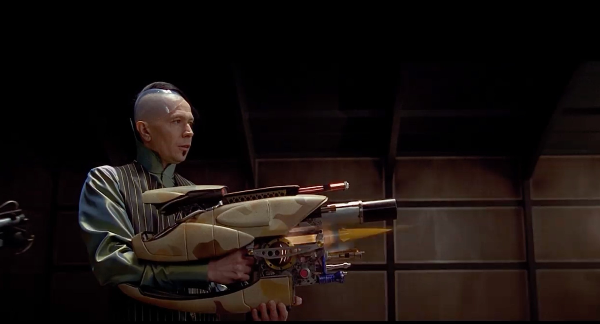



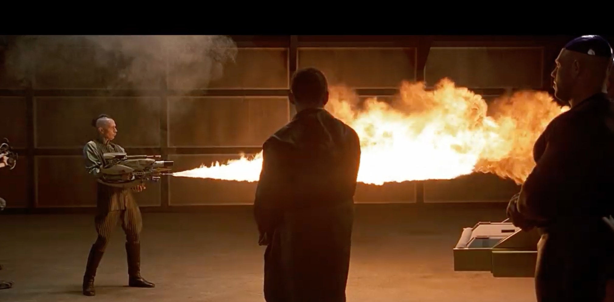



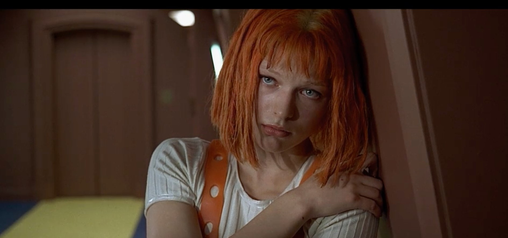



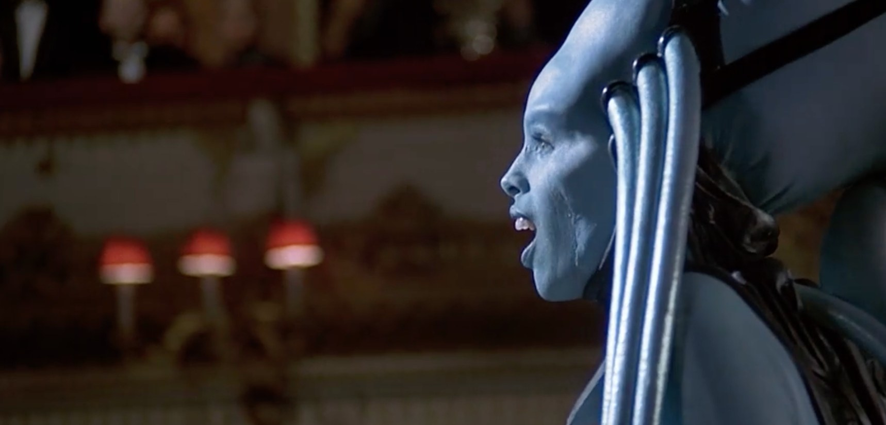



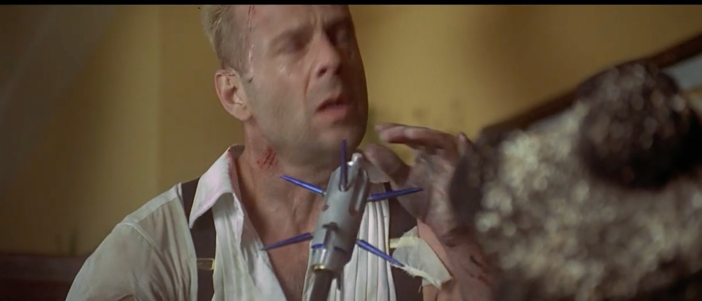



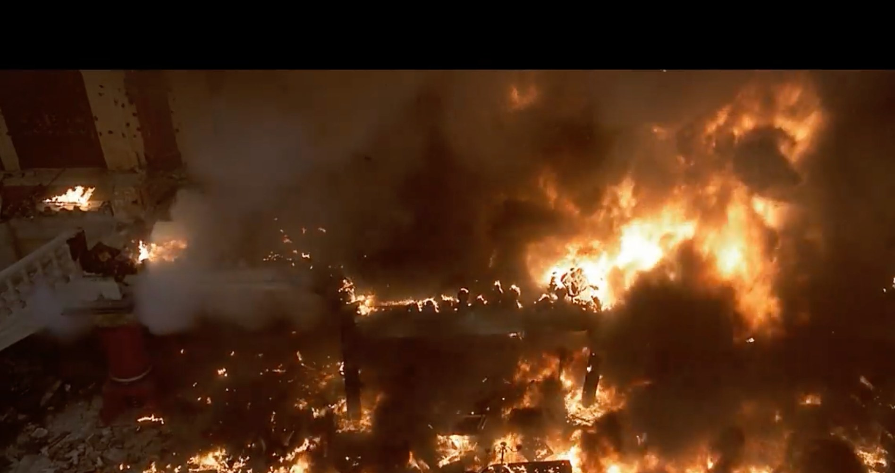



## Synopsis (spoiler-free)

A futuristic cab driver's latest passenger, a woman created from an alien cell, may be mankind's last hope of saving Earth from impending doom.

## Review (spoilers ahead)

The film opens in Egypt in 1914, where a religious order guards an ancient prophecy. A scientist deciphering the walls of a temple stumbles onto its secret: aliens have hidden four sacred stones there, along with a fifth element that is the only thing able to stop a great evil. He ends up watching as the aliens arrive to take their holy grail away. They tell the priest that Earth is no longer safe, hand him a key, and promise to return in 300 years, when the evil comes back.

Then we cut to the future, where a giant ball of evil is heading for Earth. Korben Dallas (Bruce Willis) is a former soldier turned cab driver, living in a crowded, crime-ridden New York where the traffic flies. The aliens are on their way back with the stones, but their ship is shot down, and all that survives is a single hand. Scientists use its cells to rebuild the being inside: Leeloo (Milla Jovovich), the fifth element herself. She escapes the lab, leaps off a ledge to get away from the police, and falls straight through the roof of Korben's cab.

The stones weren't on the alien ship. They had been entrusted to Diva Plavalaguna, an alien opera star who is about to perform aboard Fhloston Paradise, a luxury cruise liner in space. Suddenly everyone needs a way onto that ship.

From there, everything happens at once. The military rig a radio competition so that Korben wins a holiday on Fhloston Paradise and can go undercover to collect the stones. Father Vito Cornelius (Ian Holm), the priest who now guards the prophecy, finds out and wants the tickets for himself. Meanwhile Zorg (Gary Oldman), a ruthless businessman secretly working for the evil, wants the stones too, and sends his police to kill Korben. When everyone converges on Korben's tiny apartment, it turns into a farce: the military hide under the shower, the priest ends up in the cupboard and Leeloo in the autowash. The priest knocks Korben out and steals the ticket, and the military get frozen.

On board the ship, Korben has to appear on the show of Ruby Rhod (Chris Tucker), a shrieking, flamboyant radio host broadcasting live from the cruise. Ruby is pure craziness, and the backing track behind his show is such a staple of the late '90s. The drum tracks have no dynamics at all, which screams of the move from analogue to digital audio.

Even in paradise, Korben can't escape his troubles, though he has no idea they're coming. Zorg and his hired muscle, the Mangalores (shape-shifting alien mercenaries), have made their way aboard too.

Korben attends the Diva's opera while Leeloo fights the Mangalores for the stones, and then Zorg arrives and tries to take them from her. During the attack the Diva is shot. Before she dies, she tells Korben who Leeloo really is, and that he must help her and love her, because without that Leeloo will die.

Zorg grabs the case that was supposed to hold the stones and escapes in his ship, but it's empty. It isn't until Korben asks the dying Diva where the stones are that she tells him they are inside her.

Right at the end it turns into Die Hard, with explosions, machine guns and snappy one-liners as Korben fights his way off the ship.

It finishes back in the Egyptian temple, with the ball of evil bearing down on Earth and time ticking away as they work out how to activate the four stones, one for each element, to unlock the fifth. The four are Earth, Fire, Wind and Water, and the fifth element turns out to be Love. It sounds like Captain Planet in the future.

## Standout moments

* When Leeloo falls into his cab, she explains what happened in her ancient alien language, and the only thing Korben understands is "budda boom"
* The multi-function gun that Zorg demonstrates to the Mangalores
* The flying Chinese restaurant, a boat that pulls up to apartment windows to deliver takeaway
* The music, a perfect snapshot of the late '90s
* "Leeloo Dallas, Multipass": Leeloo proudly showing off her new name and ID card at the spaceport
* The alien opera, with the Diva's unforgettable performance
* The opening of the stones and the awakening of the fifth element

## Verdict

This film has it all. My five favourite elements are:

* The cinematography
* The music
* The action
* The storyline
* The costumes

It starts out like an Indiana Jones-style adventure in ancient Egypt, with aliens thrown in. Then it jumps to the future and plays out like a Snatch-style caper, with several groups chasing the same prize and their paths conveniently colliding at every turn. It ends on a Die Hard note, followed by a happy, romantic finish where everyone except the bad guys lives happily ever after. And I couldn't help noticing how closely the five elements match Captain Planet's Earth, Fire, Wind, Water and Heart. Just saying.

The story was pretty hard to follow at times, but it was pure entertainment, and I loved it. 5/5.
